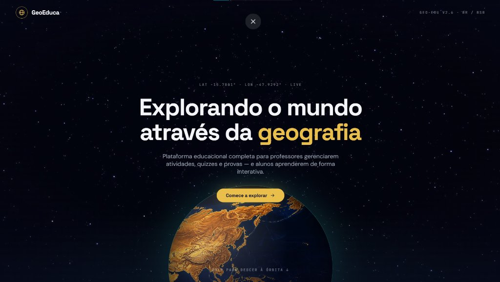
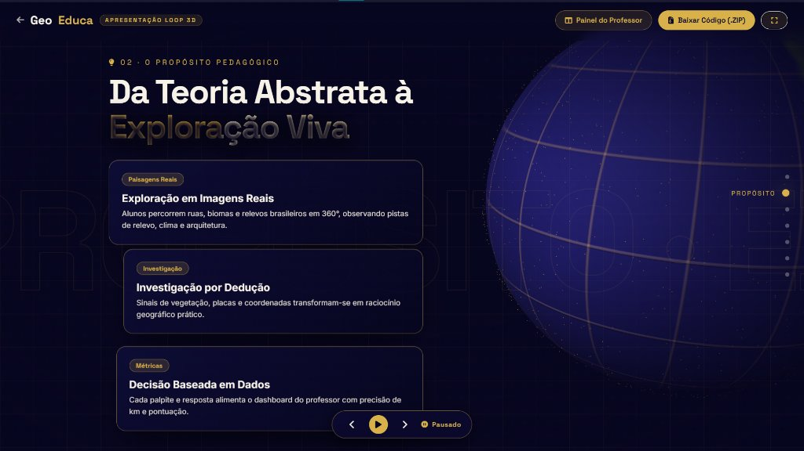
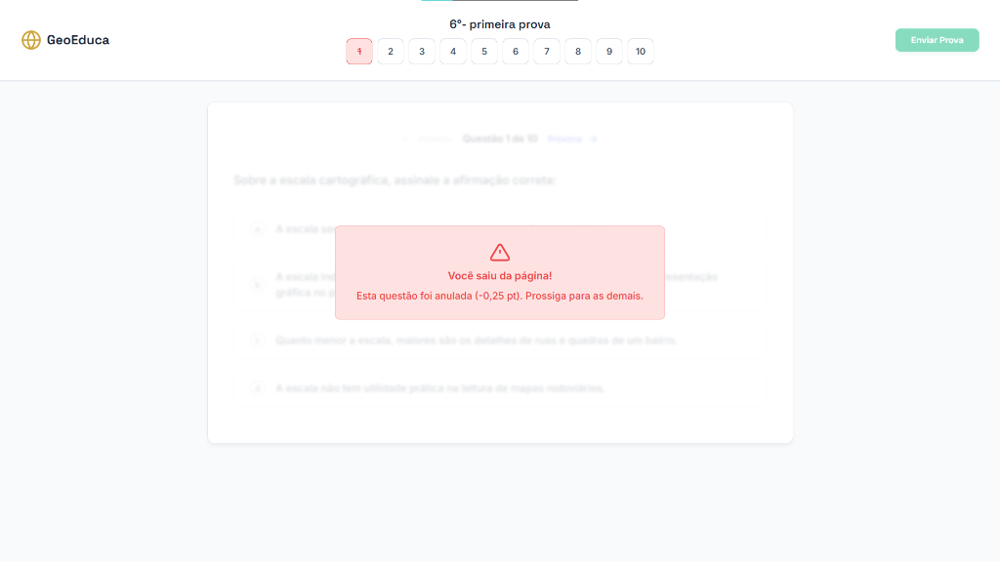

# 🌍 GeoEduca — Plataforma Educacional de Geografia

<div align="center">



<br/>

[](https://nodejs.org/)
[](https://expressjs.com/)
[](https://firebase.google.com/)
[](https://threejs.org/)
[](https://leafletjs.com/)
[](#)
[](#)

<p align="center">
  <strong>Explorando o mundo através da Geografia com gamificação, mapas interativos em 360°, inteligência visual e avaliações digitais com tecnologia anti-cola.</strong>
</p>

</div>

---

## 📖 Sumário

- [Visão Geral](#-visão-geral)
- [Capturas de Tela](#-capturas-de-tela)
- [O Mascote Oficial: Copero Explorador](#-o-mascote-oficial-copero-explorador)
- [Jogos e Gamificação](#-jogos-e-gamificação)
- [Sistema de Provas com Anti-Cheat](#-sistema-de-provas-com-anti-cheat)
- [Perfis de Acesso](#-perfis-de-acesso)
- [Tecnologias Utilizadas](#-tecnologias-utilizadas)
- [Estrutura do Projeto](#-estrutura-do-projeto)
- [Como Executar Localmente](#-como-executar-localmente)
- [Deploy em Nuvem](#-deploy-em-nuvem)
- [Equipe](#-equipe)

---

## 🧭 Visão Geral

O **GeoEduca** é um ecossistema educacional completo desenvolvido para transformar a aprendizagem de Geografia no Ensino Fundamental e Médio. Ele combina gestão pedagógica de alto nível para professores com experiências imersivas e gamificadas para os alunos, tudo integrado a dados geográficos e ambientais do acervo oficial do **IBGE Educa**.

### Destaques do Projeto:
- 🗺️ **Apresentação em Loop 3D**: Experiência visual com rotação de globo realista via WebGL e Three.js.
- 🎮 **Universo de Jogos**: Exploração geográfica em 360°, desafios de biomas, adivinhação de bandeiras, capitais e placas tectônicas.
- 📝 **Provas Digitais Seguras**: Cronômetro regressivo com correção imediata e mecanismo avançado anti-cola com detecção de perda de foco e tela cheia obrigatória.
- 📊 **Dashboards Inteligentes**: Relatórios de desempenho por sala, taxas de acerto e ranking pedagógico.

---

## 📸 Capturas de Tela

<div align="center">

### 🌐 Apresentação Interativa em Loop 3D
*Globo terrestre WebGL renderizado com Three.js e animação fluida por scroll com Lenis.*
<br/>


<br/><br/>

### 📝 Ambiente de Provas Digitais & Anti-Cheat
*Interface com proteção multicamadas: tela cheia obrigatória, detecção de perda de foco e anulação automática de questões em caso de cola.*
<br/>


</div>

---

## 🦫 O Mascote Oficial: Copero

<div align="center">
  
  <p><em>"Copero — O mascote oficial do GeoEduca, trazendo carisma, apoio e incentivo para os estudantes em cada etapa da jornada pedagógica."</em></p>
</div>

O **Copero** é a simpática capivara mascote oficial do GeoEduca. Criado com uma identidade visual acolhedora e divertida, o personagem acompanha o estudante durante toda a sua experiência na plataforma:
- **Feedbacks Positivos e Didáticos:** Comemora vitórias, acolhe erros e traz explicações com rigor científico.
- **Rigor Científico:** Dados reais das **27 Unidades Federativas** e dos **6 Biomas Brasileiros** (Amazônia, Caatinga, Cerrado, Mata Atlântica, Pampa e Pantanal).

---

## 🎮 Jogos e Gamificação

O GeoEduca possui módulos de jogos desenhados para fixação ativa de conteúdo:

| Jogo | Descrição | Tecnologia |
| :--- | :--- | :--- |
| **BrazilGuessr** | Jogo de exploração geográfica onde o aluno é lançado em uma paisagem brasileira em 360° e deve localizar o ponto exato no mapa interativo com cálculo de distância em km. | Google Street View + Leaflet |
| **Detetive Brasil** | Enigmas e pistas progressivas sobre relevo, clima, hidrografia e vegetação para descobrir os estados brasileiros. | SVGs Interativos + Animações |
| **Missão Brasil (GeoBr)** | Desafio sobre as capitais, bandeiras, biomas e dados socioeconômicos do Brasil. | Canvas + Engine de Quiz |
| **Placas Tectônicas 3D** | Visualização tridimensional da dinâmica da litosfera, limites convergentes, divergentes e transformantes. | Three.js + WebGL |

---

## 🛡️ Sistema de Provas com Anti-Cheat

Para assegurar a integridade acadêmica em avaliações escolares, o módulo de provas conta com proteção multicamadas:

- **Modo Tela Cheia Obrigatório (HTML5 Fullscreen API):** A prova entra em tela cheia ao iniciar. Sair do modo tela cheia gera aviso imediato e anulação da questão (-0,25 pt).
- **Detecção de Perda de Foco (`window.onblur`):** Identifica cliques fora da prova, janelas flutuantes e painéis laterais de inteligência artificial (ex: *"Peça ao Gemini"* ou *Microsoft Copilot*).
- **Cortina de Privacidade com Blur:** Se o foco for perdido, uma cortina visual cobre a pergunta e as opções instantaneamente, impedindo leitura ou raspagem de tela.
- **Bloqueio de Teclado e Mouse:** Desativação de botão direito (`contextmenu`), seleção de texto (`user-select: none`), cópia/colagem e atalhos de desenvolvedor (`F12`, `Ctrl+C/V/U`, `Ctrl+Shift+I`).

---

## 👥 Perfis de Acesso

O sistema dispõe de controle de acesso rigoroso baseado em papéis (RBAC via JWT):

1. **Aluno (`aluno`)**
   - Entrada facilitada por RM ou E-mail.
   - Acesso às turmas vinculadas, provas ativas, histórico de notas e jogos educativos.
2. **Professor (`prof`)**
   - Criação e aplicação de provas com tempo cronometrado e pontuação customizada.
   - Gerenciamento de salas, monitoramento do BrazilGuessr e correção automatizada.
3. **Escola / Coordenação (`escola`)**
   - Gestão institucional de turmas e professores.
   - Redefinição administrativa e segura de senhas para alunos e professores.
4. **Master Admin (`master`)**
   - Acesso global à infraestrutura, métricas e controle geral do sistema.

---

## 💻 Tecnologias Utilizadas

### Frontend
- **HTML5 & CSS3 Avançado:** Design system personalizado construído do zero, variáveis de cor no espaço perceptivo `oklch` e suporte a Dark Mode.
- **JavaScript (ES6+ Vanilla):** Arquitetura modular sem overhead de frameworks pesados, garantindo carregamento instantâneo.
- **Three.js & WebGL:** Renderização 3D do planeta Terra com atmosfera, iluminação e texturas de alta definição.
- **Leaflet.js:** Mapas dinâmicos vetoriais e pins interativos.
- **Lenis Smooth Scroll:** Experiência suave de navegação parallax.

### Backend
- **Node.js & Express.js:** API RESTful modular, segura e performática.
- **Firebase Firestore (Admin SDK):** Banco de dados em nuvem NoSQL com persistência em tempo real.
- **Autenticação JWT & Bcrypt:** Criptografia de senhas e geração de tokens stateless.
- **Segurança:** Headers seguros via Helmet, proteção CORS e rate-limiting contra requisições abusivas.

---

## 📂 Estrutura do Projeto

```text
GeoEduca/
├── backend/                   # API RESTful Node.js + Firebase
│   ├── src/
│   │   ├── controllers/      # Autenticação, Provas, Salas, Quizzes
│   │   ├── middlewares/      # Validação de JWT e RBAC
│   │   ├── routes/           # Rotas da API (/api/auth, /api/provas...)
│   │   └── services/         # Envio de e-mails e regras de negócio
│   └── server.js             # Ponto de entrada do servidor
├── frontend/                  # Aplicação Web Client
│   ├── aluno/                # Painel do Aluno, Provas, Jogos e Hubs
│   ├── professor/            # Painel do Professor, Apresentação 3D, Analytics
│   ├── escola/               # Painel Administrativo Escolar
│   ├── master/               # Painel do Master Admin
│   ├── css/                  # Folhas de estilo e Design System
│   └── js/                   # Controladores da interface e chamadas de API
├── BrazilGuessr/              # Módulo do jogo de exploração 360°
├── JOGOS/                     # Módulos dos jogos educativos (Detetive, GeoBr)
├── placas-tectonicas-3d/      # Simulador 3D de relevo e placas
├── docs/                      # Relatórios de testes e documentação
│   └── screenshots/          # Capturas de tela oficiais da plataforma
├── iniciar.bat               # Inicializador rápido de desenvolvimento
└── README.md                  # Documentação principal
```

---

## 🚀 Como Executar Localmente

### Pré-requisitos
- **[Node.js](https://nodejs.org/)** (versão 18 ou superior instalada)

### Método 1: Inicialização Automática (Windows)
Basta dar um duplo clique no arquivo **`iniciar.bat`** na raiz do projeto. Ele irá:
1. Instalar as dependências do backend se necessário.
2. Iniciar o servidor Node.js na porta configurada.
3. Abrir o GeoEduca automaticamente no seu navegador padrão.

### Método 2: Inicialização Manual
```bash
# 1. Clone o repositório
git clone https://github.com/fonseca-felix/GeoEduca.git
cd GeoEduca

# 2. Acesse a pasta do backend e instale as dependências
cd backend
npm install

# 3. Inicie o servidor
npm start
```
Após iniciar, abra seu navegador em `http://localhost:3000`.

---

## ☁️ Deploy em Nuvem

O GeoEduca está configurado para deploy imediato no **Render** (ou serviços similares como Railway / Fly.io / Heroku). O `server.js` gerencia a API e serve os arquivos estáticos do `frontend`.

### Variáveis de Ambiente Recomendadas:
| Variável | Descrição |
| :--- | :--- |
| `PORT` | Porta de escuta da aplicação (ex: `3000` ou atribuída dinamicamente). |
| `FIREBASE_CREDENTIALS` | JSON serializado com as chaves de Service Account do Firebase. |
| `JWT_SECRET` | Chave de criptografia dos tokens JWT. |
| `JWT_EXPIRES_IN` | Validade dos tokens de sessão (ex: `7d`). |

---

## 👥 Equipe & Colaboradores

Projeto desenvolvido no âmbito do curso técnico em Desenvolvimento de Sistemas — **SENAI**:

- **Félix Fonseca** — [@fonseca-felix](https://github.com/fonseca-felix)
- **Luiz Felipe Barros** — [@LuizFelipeBarros](https://github.com/LuizFelipeBarros)
- **Pietro Mantuan** — [@mantuanpietro](https://github.com/mantuanpietro)
- **Joaquim Neto** — [@JoaquimNeto17](https://github.com/JoaquimNeto17)

---

<div align="center">
  <sub>GeoEduca — Construído com paixão para transformar a educação geográfica.</sub>
</div>
